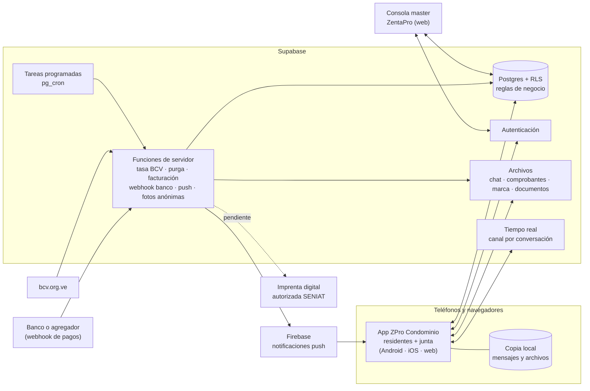

# ZPro Condominio · Arquitectura v0.2 (escala: 100 condominios)

> ⚠ **Superado por [ARQUITECTURA_v0.3.md](ARQUITECTURA_v0.3.md)**: ya no se usa Supabase; el servidor es propio. Lo demás (chat, documentos, pagos, consola) sigue vigente.

*27-oct-2026 · Technical Digital TD, C.A. · Documento de trabajo: se va ajustando con cada decisión.*

## 1. Resumen

| Tema | Decisión propuesta |
|---|---|
| **Servidor** | **DigitalOcean** (donde ya vive ZentaPro), con **Supabase autoalojado** (software libre: Postgres + autenticación + API + archivos). Droplet **aparte** del de ZentaPro |
| **Tamaño** | 100 condominios × 250 casas = **25.000 unidades**, ~40.000 cuentas, ~3.000 conectadas a la vez en hora pico |
| **Costo de servidor** | Piloto **$6/mes** (Droplet de 1 GB, respaldo propio gratis) · ~30 condominios ≈ $36–67 · 100 condominios ≈ **$131/mes**. Se crece solo cuando entren contratos |
| **Ingreso a 100 condominios** | 25.000 unidades × $0,30–0,45 = **$7.500–11.250/mes** → el servidor es menos del 2 % |
| **Apps** | 1) App de residentes y junta (Android, iOS, web) · 2) **Consola master** de ZentaPro (web aparte) |
| **Chat** | Tipo WhatsApp por **casa** ("Casa 28 · Familia Pérez"), con la junta y entre vecinos. **No anónimo.** Archivos en el servidor 15–60 días; copia permanente en cada teléfono |
| **Documentos** | PDF y Excel con la **marca de cada condominio** (logo, foto de la entrada, nombre de la asociación). Excel se abre gratis en Google Sheets. Actas con espacio para **firma y sello** y **código QR** de verificación |
| **Cobro a residentes** | Pago Móvil/transferencia/Zelle a la cuenta del **condominio**. Confirmación automática en 3 niveles: manual → **extracto bancario** (todos los bancos) → **API bancaria** (en segundos) |
| **Cobro de ZentaPro** | Suscripción mensual por unidad, **facturada en bolívares a tasa BCV**, pagada por Pago Móvil a ZentaPro, conciliada con el mismo motor; suspensión automática a solo lectura tras 10 días de gracia |

## 2. Dimensionamiento

Supuestos (conservadores; se ajustan con el piloto):

| Variable | Supuesto | Resultado a 100 condominios |
|---|---|---|
| Unidades | 100 × 250 | 25.000 |
| Cuentas por unidad | 1,6 (propietario + familiar/inquilino) | ~40.000 cuentas |
| Usuarios activos al mes | 75 % | ~30.000 (Supabase incluye 100.000) |
| Conectados a la vez (pico) | 10 % de los activos | ~3.000 conexiones en tiempo real |
| Mensajes de chat | 2 por usuario activo al día | ~1,8 millones/mes |
| Entregas en tiempo real | ~8 por mensaje (grupos y canales) | ~15 millones/mes |
| Fotos y archivos del chat | 5 % de los mensajes, ~400 KB | ~1,2 GB/día → ~40 GB en el servidor con 30 días de retención |
| Comprobantes y facturas | 25.000 pagos/mes × 300 KB | ~7,5 GB/mes (se guardan, son soporte contable) |
| Base de datos | Pagos, cargos, mensajes de texto (24 meses) | ~20 GB el primer año, ~40 GB el segundo |
| Descargas | Cada archivo se baja ~2 veces | ~250–300 GB/mes |

**Conclusión:** para esta escala no hace falta un clúster. Un solo servidor de 8 núcleos y 16 GB atiende 25.000 unidades con holgura; con uso esporádico, incluso menos. El piloto arranca en 1 GB.

## 3. Servidor y costos (decisión: DigitalOcean, crecer por etapas)

Criterio acordado: **no gastar en infraestructura que todavía no produce dinero.** El uso es esporádico (pagos,
consultas, reportes, algún chat), no continuo.

| Etapa | Droplet | Respaldo | Costo/mes |
|---|---|---|---|
| **Piloto** (1–3 condominios) | Básico 1 GB / 1 núcleo / 25 GB | Propio: script nocturno a Google Drive (gratis) | **$6** |
| Primeros contratos (~10) | 2 GB | Propio + semanal de DigitalOcean | ≈ $15 |
| ~30 condominios | 4–8 GB + Spaces para archivos | Propio + diario de DigitalOcean | ≈ $36–67 |
| ~100 condominios | 8 núcleos / 16 GB / 320 GB + Spaces | Ídem | ≈ $131 |

**Piloto en 1 GB = Supabase reducido:** Postgres, inicio de sesión, API y archivos. Sin el servicio de tiempo real
(el chat consulta cada 5 s con la sala abierta, más notificaciones push) y con las tareas programadas como scripts del
sistema. Detalle, consumo de RAM por pieza y respaldo en `despliegue/digitalocean/README.md`.

Para comparar: el mismo sistema en Supabase administrado costaría ≈ $30 en piloto y $290–390 a 100 condominios
(incluye mantenimiento, respaldo a cualquier minuto y tiempo real). Se descartó por costo; la app funciona igual en
ambos, así que la decisión se puede revisar sin reescribir nada.

## 4. Componentes

| Pieza | Dónde está en el código |
|---|---|
| Esquema y reglas (10 archivos SQL) | `app/supabase/migrations/0001…0010` |
| Pruebas de reglas y permisos | `app/supabase/pruebas/` (`npm run test:db`) |
| Funciones de servidor | `app/supabase/functions/` |
| App de residentes y junta | `app/src/` |
| Plantillas PDF/Excel | `app/src/documentos/` |
| Consola master | `consola/` |

## 5. Multi-condominio y consola master

- **Un solo servidor para todos.** Cada fila de cada tabla lleva su condominio; la seguridad por filas (RLS) impide que un condominio vea datos de otro. Está probado.
- **Alta (la hace ZentaPro desde la consola):** datos del conjunto, tipo (edificio, conjunto, urbanización), marca (nombre de la asociación, RIF, logo, foto de la entrada, color), importación de casas desde Excel (bloque, número, tipo, alícuota, propietario; las alícuotas deben sumar 100 %), plan y días de prueba.
- **Activación:** la consola genera un **código de activación** que se le entrega al presidente; al usarlo en la app queda como presidente. Luego él (o ZentaPro) genera **códigos por casa** para que cada familia se una; Presidencia aprueba cada solicitud.
- **Estados del condominio:** prueba → activo → suspendido (solo lectura, por falta de pago a ZentaPro; los residentes **sí** pueden seguir reportando pagos) → baja. Se reactiva solo al confirmarse el pago.
- **Privacidad por diseño:** el personal de ZentaPro ve datos **comerciales** (estado, plan, facturas, métricas agregadas como % de adopción y % de morosidad). **No** ve chats, pagos de residentes ni autoría de reportes anónimos. Probado.

## 6. Chat

**Quién habla con quién**

| Conversación | Partes | Quién escribe | Ejemplo |
|---|---|---|---|
| Directa | Casa ↔ casa | Ambas casas | "Apto B-33 → Casa 11: ¿su carro es el gris?" |
| Con la junta | Casa ↔ junta | Ambas | Presidencia → Casa 28: recordatorio de saldo · Casa 28 → Presidencia: consulta |
| Grupo | Varias casas + junta | Todos | "Bloque B", "Comisión de pintura" |
| Canal | Junta → todas las casas | Solo la junta | "Avisos oficiales" |

- **Identidad:** cada mensaje muestra la casa (seudónimo: "Casa 28", "Apto B-34") y la persona. **No hay anonimato en el chat.** Lo único anónimo son los **reportes** de averías o quejas.
- **Directorio:** lista de casas con "a nombre de quién está". Cada residente puede ocultar su nombre a los **vecinos**; la junta siempre lo ve. Nunca se muestran teléfonos ni correos.
- **Privacidad entre vecinos:** la junta **no** lee las conversaciones privadas entre casas. Si alguien denuncia un mensaje, la junta ve **ese** mensaje. Cualquier casa puede **bloquear** a otra.
- **Constancia:** ✓ enviado, ✓✓ entregado, ✓✓ azul leído (por casa). Exportar la conversación a texto con fecha, hora y autor.
- **Archivos:** fotos, PDF, Excel y audio hasta 25 MB. Quedan en el servidor **15 días (plan Básico) o 60 días (plan Completo)**; luego se borran. Cada teléfono los **descarga y guarda al recibirlos** (en Android, en la carpeta Documentos/ZPro Condominio), así queda la constancia en cada dispositivo aunque el servidor ya no los tenga.
- **Texto:** se conserva en el servidor 24 meses (configurable por condominio).
- **Notificaciones:** push con Firebase. Cada conversación se puede silenciar.
- **Cifrado:** en tránsito (TLS) y en reposo en el servidor. **No es de extremo a extremo** como WhatsApp: eso impediría conservar el historial para la constancia y sincronizar varios teléfonos de la misma casa. Se informa así a los usuarios.

## 7. Documentos con la marca del condominio

| Documento | Formato | Quién lo descarga |
|---|---|---|
| Estado de cuenta | PDF y Excel | Residente (su casa) · junta (cualquiera) |
| Recibo del mes | PDF | Residente · junta |
| Solvencia (solo si no debe) | PDF con QR | Residente · junta |
| Relación de gastos del mes | Excel y PDF | Todos (transparencia) |
| Acta de votación: resultado ponderado por alícuota, voto de cada apartamento, espacio para **firma y sello** | PDF | Junta |
| Reporte de morosidad | Excel | Junta |

- Encabezado: logo, nombre del condominio y de la asociación, RIF, dirección; color del condominio; foto de la entrada como portada del estado de cuenta y del acta.
- Cada documento lleva un **código y un QR**. Quien lo escanee (un banco, un comprador del apartamento) ve en zentapro.com/verificar si es auténtico y vigente, sin necesitar cuenta.
- Excel (.xlsx) se abre gratis en Google Sheets, LibreOffice y Excel. No hace falta conectar Google.
- **Valor legal:** en Venezuela los mensajes de datos tienen la misma eficacia probatoria que los documentos escritos (Ley sobre Mensajes de Datos y Firmas Electrónicas, art. 4). Una firma electrónica certificada equivale a la autógrafa (arts. 16 y 18), pero exige un proveedor acreditado. Por eso el acta se imprime y se firma y sella a mano; el QR prueba que el contenido no se alteró. *No es asesoría legal.*

## 8. Pagos: cómo se automatizan

### 8.1 Residentes → cuenta del condominio

El dinero **nunca pasa por ZentaPro**: va directo a la cuenta del condominio. Así no hace falta licencia de intermediario de pagos.

| Nivel | Cómo funciona | Bancos | Cuándo |
|---|---|---|---|
| 1. Manual | El residente reporta (monto, referencia, captura) y Tesorería confirma | Todos | Ya hecho (v0.1) |
| 2. **Extracto** | Tesorería descarga el movimiento de su banca en línea (Excel/CSV) y lo sube. El sistema cruza **últimos 6 dígitos de la referencia + monto exacto + fecha ±3 días** y confirma solos los que coinciden. Lo que entró sin aviso queda en "dinero no identificado" para asignarlo a una casa | **Todos** | **Base hecha y probada (v0.2)** |
| 3. **API / agregador** | El banco avisa cada crédito al servidor (webhook) y el pago se confirma en segundos | Según contrato: hay agregadores como Pabilo (Banco de Venezuela, Mercantil, Banesco, Provincial) y bancos con API propia (Mercantil, Activo) | Esqueleto hecho; se activa banco por banco |

Detalles que ya resuelve el sistema: referencias repetidas, pagos parciales y adelantados (saldo a favor), equivalencia Bs→$ con la tasa BCV del día del pago, y bitácora de quién confirmó y por qué vía.

### 8.2 Condominio → ZentaPro (nuestro cobro)

1. **Día 1 de cada mes**, una tarea automática emite la factura de cada condominio activo: unidades × precio del plan (mínimo mensual), convertido a **bolívares a la tasa BCV** de ese día.
2. La junta la ve en su app y paga por **Pago Móvil o transferencia a la cuenta de ZentaPro**.
3. La confirmación usa el **mismo motor de conciliación** (extracto o API de la cuenta de ZentaPro).
4. A los **10 días** de vencida, el condominio pasa a **solo lectura**; al pagar se reactiva solo.
5. **Factura fiscal:** el SENIAT exige factura digital a través de una **imprenta digital autorizada** a quien vende por medios electrónicos (Providencia publicada en Gaceta Oficial 43.032, vigente desde el 1-mar-2025). Hay que contratar una e integrar su API para obtener el número de control. El campo ya existe. *Confirmar con el contador.*

Planes propuestos (para validar): **Básico $0,30**/unidad/mes (mínimo $25; archivos 15 días) y **Completo $0,45**/unidad/mes (mínimo $40; archivos 60 días y conciliación por API). Para comparar: Recinta cobra desde $39/mes.

## 9. Seguridad y respaldo

- Reglas en la base de datos (RLS), no en la app: un teléfono manipulado no salta permisos.
- Lo que mueve dinero pasa solo por funciones del servidor y queda en la bitácora.
- Credenciales bancarias en el **Vault** de Supabase, nunca en tablas ni en la app.
- Reportes anónimos: autoría en tabla inaccesible; fotos subidas sin dueño. **Pendiente:** borrar los metadatos de las fotos (EXIF: GPS, modelo del teléfono) antes de guardarlas.
- Respaldos diarios incluidos; se recomienda la recuperación a cualquier minuto (PITR) desde que haya dinero real.
- Junta y consola: recomendable exigir segundo factor (código por correo o app) para quien confirma pagos.

## 10. Riesgos

| Riesgo | Mitigación |
|---|---|
| Servidor de 1 GB se queda corto | Vigilar RAM; subir a 2 GB ($12) con "Resize" en minutos |
| Mantenimiento propio (actualizaciones, respaldos) | Scripts de respaldo y restauración; ensayar la restauración cada mes |
| La página del BCV cambia y falla la lectura de la tasa | La función avisa del error; la junta puede cargar la tasa a mano; fuentes alternas de código abierto |
| Los bancos no dan API a todos | El nivel 2 (extracto) funciona con todos; la API es una mejora, no un requisito |
| Conectividad intermitente | La app guarda copia local; los mensajes salientes se reintentan |
| Disputas legales por votaciones | Votación configurable por umbral; acta con firma y sello; validar con abogado |
| Abuso en el chat | No anónimo, bloqueo, denuncia y límites de envío |

## 11. Plan de construcción

| Fase | Contenido | Estado |
|---|---|---|
| 0 | Esquema, reglas y pruebas: finanzas, votaciones, reportes, multi-condominio, chat, documentos, conciliación, cobro ZentaPro | **Hecho (este esqueleto)** |
| 1 · Servidor piloto | Droplet de $6 en DigitalOcean con Supabase reducido, migraciones, scripts de tareas y respaldo, Firebase, dominio y zentapro.com/verificar | Cuando la app esté ensamblada |
| 2 · Piloto | 2 condominios en Aragua: alta desde la consola, códigos por casa, pagos con extracto, chat y documentos | Tras la fase 1 |
| 3 · Publicación | APK firmado (llave propia), Play Store a nombre de Technical Digital TD (cuando llegue el D-U-N-S), política de privacidad | Con el piloto |
| 4 · Automatización | Primer banco o agregador por API, imprenta digital para facturas de ZentaPro, segundo factor | Tras validar precio |
| 5 · Escala | Monitoreo, PITR, subir cómputo según uso, iOS | Hacia 30–100 condominios |

## 12. Preguntas abiertas

1. ¿El cobro de ZentaPro será solo en Bs a tasa BCV, o también se aceptan dólares (Zelle o efectivo)?
2. ¿Precio por unidad: se mantienen $0,30/$0,45 o prefieren otra cifra?
3. ¿Retención del chat: 15/60 días de archivos y 24 meses de texto les parece bien?
4. ¿Los vecinos pueden escribirse entre sí desde el primer día, o se deja que cada junta lo active?
5. ¿Qué banco usan los condominios del piloto y ZentaPro? Define con qué API o agregador empezar.

## Fuentes

- [Supabase · precios](https://supabase.com/pricing) · [límites de tiempo real](https://supabase.com/docs/guides/realtime/limits)
- [DigitalOcean · precios de Droplets](https://www.digitalocean.com/pricing/droplets) · [Spaces](https://www.digitalocean.com/pricing/spaces-object-storage)
- [Supabase autoalojado con Docker (requisitos)](https://supabase.com/docs/guides/self-hosting/docker)
- [Pabilo para WooCommerce (verificación de Pago Móvil)](https://es-mx.wordpress.org/plugins/pabilo-payment-gateway-for-woocommerce/)
- [Integraciones Mercantil / Banco de Venezuela (documentación de terceros)](https://www.mintlify.com/Zeto96/tmt-doc-6/banking/overview)
- [Activo Banco Universal lanza APIs para empresas](https://ecosistemastartup.com/activo-banco-universal-lanza-apis-para-empresas-en-venezuela/)
- [Facturación digital SENIAT (Forvis Mazars)](https://www.forvismazars.com/ve/es/insights/forvis-mazars-insights/fmi-0125-facturacion-digital)
- [Ley sobre Mensajes de Datos y Firmas Electrónicas](https://venezuela.justia.com/federales/decretos/decreto-n-1-204/gdoc)
- [Proyectos de código abierto para la tasa BCV](https://github.com/topics/bcv)
